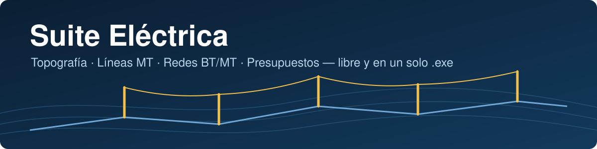

<p align="center">
  
</p>

<p align="center">
  <b>Suite libre para ingeniería eléctrica de distribución en Perú</b><br>
  Topografía, líneas primarias, redes de distribución y presupuestos en un solo ejecutable, sin instalar nada.
</p>

<p align="center">
  <a href="https://github.com/gaelrenzo/suite-electrica/releases/download/v0.1.0-rust/suite-electrica.exe"></a>
</p>

<p align="center">
  <a href="LICENSE"></a>
  <a href="https://github.com/gaelrenzo/suite-electrica/releases"></a>
  <a href="https://github.com/gaelrenzo/suite-electrica/actions/workflows/rust.yml"></a>
  <a href="https://github.com/gaelrenzo/suite-electrica/actions/workflows/pruebas.yml"></a>
  
</p>

---

## ¿Qué es?

Suite Eléctrica reúne en una sola aplicación de escritorio el flujo completo de un proyecto de
electrificación: **del levantamiento topográfico al presupuesto**. Es una alternativa libre a las
herramientas comerciales que se usan en Perú, construida a partir de la normativa pública
(CNE Suministro 2011, normas DGE/MINEM) y validada número a número contra ellas.

| | Módulo | Hace | Equivale a |
|---|---|---|---|
| 🗺️ | **TopoCraft** | Limpieza de puntos, TIN, curvas de nivel, perfil longitudinal, relieve SRTM | TOPOMAGIC |
| ⚡ | **LineCraft** | Líneas primarias MT: ubicación de postes, cálculo mecánico, despejes, cargas, retenidas, flechado | REDLIN |
| 🔌 | **GridCraft** | Redes BT/MT en planta: caída de tensión, pérdidas, autodiseño de conductores, metrado | REDCAD |
| 💰 | **PresuCraft** | Presupuesto por unidades constructivas, APU, fórmula polinómica, transporte | PRESIO |

## ⬇️ Descargas (Windows 10/11)

| Programa | Descarga | Tamaño |
|---|---|---|
| **Suite Eléctrica** (app principal) | [suite-electrica.exe](https://github.com/gaelrenzo/suite-electrica/releases/download/v0.1.0-rust/suite-electrica.exe) | 22,7 MB |
| Comparador con REDLIN | [comparar-redlin.exe](https://github.com/gaelrenzo/suite-electrica/releases/download/v0.1.0-rust/comparar-redlin.exe) | 1,4 MB |
| Comparador con REDCAD | [comparar-redcad.exe](https://github.com/gaelrenzo/suite-electrica/releases/download/v0.1.0-rust/comparar-redcad.exe) | 1,6 MB |
| Comparador con PRESIO | [comparar-presio.exe](https://github.com/gaelrenzo/suite-electrica/releases/download/v0.1.0-rust/comparar-presio.exe) | 1,4 MB |
| Sumas de verificación | [SHA256SUMS.txt](https://github.com/gaelrenzo/suite-electrica/releases/download/v0.1.0-rust/SHA256SUMS.txt) | — |

Descargar y abrir: **no necesita instalación ni Python**. Versión de prueba 0.1.0 ·
[todas las versiones](https://github.com/gaelrenzo/suite-electrica/releases).

> Windows puede mostrar el aviso de SmartScreen (ejecutable sin firmar):
> *Más información → Ejecutar de todas formas*.

## ✨ Por qué usarla

- **Un solo `.exe` de 23 MB.** Los cuatro programas comerciales equivalentes pesan unos 320 MB.
- **Validada contra el software comercial.** Mismas cifras que REDLIN en catenaria, tiros, cargas
  y momentos de postes. Caída de tensión de REDCAD con diferencias ≤ 0,04 V y metrado 33/33.
  APU de PRESIO 102/102 y las 3 fórmulas polinómicas iguales.
- **Sin valores inventados.** Cada valor normativo lleva su fuente; lo que no la tiene se marca
  `PENDIENTE` o `EJEMPLO` y la app avisa.
- **Formatos de siempre.** Lee CSV, DXF, KML, GPX, MapSource, Excel RLT y TPG. Entrega planos
  DXF con lámina y cajetín, planillas Excel y memorias de cálculo en PDF.
- **Libre (MIT).** Úsala, estúdiala y mejórala.

## 🧭 Flujo de trabajo

```
 Puntos topográficos ─► TopoCraft ─► perfil ─► LineCraft ─► estructuras ─┐
                                                                         ├─► PresuCraft ─► presupuesto
                       Plano de la localidad ─► GridCraft ─► metrado ────┘
```

1. **TopoCraft:** importa los puntos, revisa el reporte de limpieza y genera curvas y perfil.
2. **LineCraft:** ubica postes automáticamente (o con el ratón sobre el perfil o la planta),
   calcula con F6 y revisa alertas, despejes y cruces.
3. **GridCraft:** dibuja la red en planta, calcula caída de tensión y autodiseña conductores.
4. **PresuCraft:** importa el metrado de LineCraft y GridCraft y calcula el presupuesto.

Guía paso a paso: [`docs/GUIA_RAPIDA.md`](docs/GUIA_RAPIDA.md).

## 📐 Fundamentos de cálculo

| Módulo | Documento |
|---|---|
| TopoCraft | [`docs/topocraft.md`](docs/topocraft.md) |
| LineCraft | [`docs/linecraft.md`](docs/linecraft.md) |
| GridCraft | [`docs/gridcraft.md`](docs/gridcraft.md) |
| PresuCraft | [`docs/presucraft.md`](docs/presucraft.md) |

Estado de la migración a Rust y validación contra los comerciales:
[`docs/PLAN_RUST.md`](docs/PLAN_RUST.md).

---

## 🛠️ Para desarrolladores

### Compilar el ejecutable (Rust)

```powershell
cd motor
cargo test --release                          # pruebas (Rust = referencia Python)
cargo build --release --bin suite-electrica   # target\release\suite-electrica.exe
```

En Windows se usa el toolchain GNU con MinGW-w64; detalles en [`docs/PLAN_RUST.md`](docs/PLAN_RUST.md).

### Versión Python (referencia)

* **Windows 11**: instalar Python 3.11+ (con "Add to PATH") y ejecutar `instalar.bat`;
  crea el acceso directo **Suite Electrica** (app) y los comandos.
* **Linux**: `python3 -m pip install -e ".[dev,gui]"` y abrir con `suite-electrica`.

Pruebas: `python -m pytest -q`.

<details>
<summary><b>Línea de comandos: TopoCraft</b></summary>

Entrada: CSV `punto,este,norte,cota,descripcion` (UTM WGS84, m) —también `;`,
coma decimal o sin encabezado (orden PENZD o PNEZD, autodetectado)— o DXF con POINT / polilíneas 3D.
También importa **KML** (Google Earth), **GPX** (GPS), **TXT de MapSource** y
**Excel RLT** formato UTM (puntos + rutas como eje), y perfiles tabulares
**TPG** / Excel *ACUMULADA/ANGULO* (en `proyecto.json`: `"perfil": {"tabla": "ruta.tpg"}`).

```bash
topocraft validar puntos.csv [--out limpio.csv]
topocraft curvas  puntos.csv --eq 1 [--mayor-cada 5] [--eje eje.dxf] --out plano.dxf
topocraft perfil  puntos.csv --eje eje.dxf [--paso 20] [--esc-h 2000 --esc-v 200] \
                  --out perfil.pdf perfil.xlsx perfil.dxf
```

Opciones comunes: `--quitar-atipicos`, `--max-lado M` (descarta triángulos largos).

Capas DXF: `PUNTOS`, `TIN`, `CURVAS_MAYORES`, `CURVAS_MENORES`, `EJE`, `PERFIL`.
Unidades del dibujo: metros.

Ejemplos:

```bash
python examples/generar_ejemplos.py
python -m suite_electrica.topocraft curvas examples/colina_gaussiana.csv --eq 1 --eje examples/eje.dxf --out examples/salidas/plano.dxf
python -m suite_electrica.topocraft perfil examples/colina_gaussiana.csv --eje examples/eje.dxf --out examples/salidas/perfil.pdf examples/salidas/perfil.xlsx
```
</details>

<details>
<summary><b>Línea de comandos: LineCraft</b></summary>

Proyecto en JSON (ver `examples/linecraft/proyecto.json`): perfil (puntos + eje, o
Excel de TopoCraft), conductor del catálogo, hipótesis, condición inicial (EDS),
límites y fuentes de cada valor normativo.

```bash
linecraft nuevo mi_linea                      # plantilla de proyecto
linecraft calcular mi_linea/proyecto.json --out mi_linea/salidas
python -m suite_electrica.linecraft calcular examples/linecraft/proyecto.json --out examples/salidas/linecraft
```

Salidas: `perfil_linea.dxf` (capas PERFIL, POSTES, CONDUCTOR, DESPEJE, TEXTO_LC),
`planilla_estructuras.xlsx` (Estructuras, Vanos, Mecanico, Cargas, Avisos) y
`memoria_calculo.pdf`. Código de salida 3 si el diseño no cumple.
</details>

<details>
<summary><b>Línea de comandos: GridCraft</b></summary>

Red radial en `nodos.csv` (padre → nodo) + catálogo de conductores + `red.json`.

```bash
gridcraft nuevo mi_red
gridcraft calcular mi_red/red.json --out mi_red/salidas
python -m suite_electrica.gridcraft calcular examples/gridcraft/red.json --out examples/salidas/gridcraft
```

Salidas: `caida_tension.xlsx` (Resumen, CaidaTension, Alertas, Avisos) y
`plano_red.dxf` (capas RED, NODOS, TEXTO_RED, ALERTAS_RED). Código 3 si no cumple.
</details>

<details>
<summary><b>Línea de comandos: PresuCraft</b></summary>

```bash
presucraft nuevo mi_presupuesto
presucraft metrado mi_linea.sel --rubro LP --out mi_presupuesto/metrado.csv
presucraft calcular mi_presupuesto/presupuesto.json --out mi_presupuesto/salidas
```
</details>

### Estructura del repositorio

```
motor/            versión Rust: app egui, cálculo, pruebas y comparadores
suite_electrica/  versión Python (referencia congelada en python-referencia-v1)
  core/  topocraft/  linecraft/  gridcraft/  presucraft/  gui/
data/             catálogos CSV        examples/  datos sintéticos
tests/            pytest               docs/      fundamentos de cálculo
```

## ⚖️ Aviso y licencia

TOPOMAGIC, REDLIN, REDCAD y PRESIO son marcas de sus dueños. Suite Eléctrica es una
implementación propia a partir de la normativa pública y la documentación de usuario: no copia
datos ni código de esos programas. Sus reportes solo se usan en local para comparar resultados.

Normativa base: Código Nacional de Electricidad (Suministro 2011), normas DGE/MINEM.
No se inventan valores normativos (ver [`data/README.md`](data/README.md)).

MIT © Renzo Mamani. CADCraft se usa solo como visor externo de DXF.
